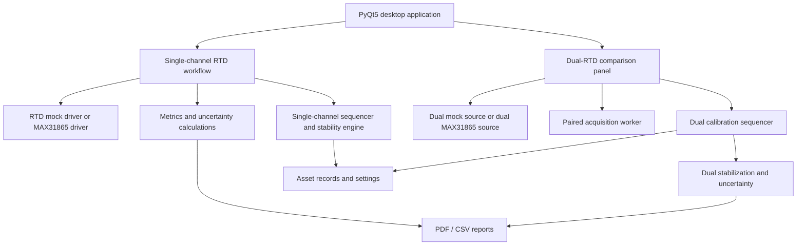

# CALIBRIX — Temperature Instrument Calibration & Validation Platform

CALIBRIX is a student-built Python application for exploring how temperature instruments can be compared, evaluated, and documented through a repeatable software workflow. The current codebase contains a single-channel RTD workflow and a dual-RTD reference-versus-device-under-test (DUT) workflow, with a PyQt5 desktop interface, simulated acquisition for development, calibration sequencing, stability checks, error metrics, uncertainty-budget calculations, and PDF/CSV reporting.

The idea behind CALIBRIX is straightforward: a temperature reading is more useful when the system also records how it was obtained, what it was compared against, how stable the readings were, how large the error was, and what evidence supports the final result. This repository is the software prototype for that approach—not a certified calibration instrument.

> **Project status:** Engineering prototype under development.

## Contents

- [What is implemented](#what-is-implemented)
- [System architecture](#system-architecture)
- [Hardware](#hardware)
- [Software requirements](#software-requirements)
- [Installation and launch](#installation-and-launch)
- [Using the application](#using-the-application)
- [Measurement logic and calculations](#measurement-logic-and-calculations)
- [Codebase guide: all 21 Python modules](#codebase-guide-all-21-python-modules)
- [Standards and technical references](#standards-and-technical-references)
- [Next development step: dual Type-K thermocouple calibration](#next-development-step-dual-type-k-thermocouple-calibration)
- [Validation still required](#validation-still-required)
- [Limitations](#limitations)

## What is implemented

### Current RTD workflows

- **Single-channel RTD workflow:** a desktop workflow for temperature measurement, validation/calibration sessions, configurable sampling and thresholds, stabilization monitoring, metrics, and report generation.
- **Dual-RTD comparison workflow:** reads a reference channel and a DUT channel as paired samples. The software records the two temperatures and resistances, calculates the signed difference `DUT − Reference`, and associates readings with a setpoint and calibration state.
- **Mock acquisition:** simulated sources allow interface and workflow development without connecting physical sensors. The dual mock includes configurable DUT offset/noise/lag/drift and fault injection.
- **Calibration sequencing:** state-machine logic organizes measurement points, collects samples, evaluates stability, and aggregates point-level results.
- **Stabilization monitoring:** evaluates temperature slope, sample spread, distance from the target setpoint, elapsed dwell time, and—in dual mode—the stability of the difference between channels.
- **Measurement metrics:** mean values, standard deviation, mean absolute error, mean bias error, root-mean-square error, relative-error metrics, validation checks, and tolerance-based verdict logic.
- **Uncertainty estimates:** preliminary uncertainty budgets include selected Type A and Type B components. Their assumptions and applicability must be reviewed before results are treated as metrologically defensible.
- **Reporting:** generation of PDF reports and CSV exports for measurements and correction tables. Report generation is a software feature; a generated report is not, by itself, proof of traceability or accreditation.
- **Asset and settings support:** local asset/calibration records and application settings are managed through supporting modules.

The repository does **not** currently contain a completed dual-thermocouple workflow. That is the next planned extension described below.

## System architecture



The application is split into UI, acquisition, sequencing, calculation, persistence, plotting, and reporting modules. This separation is intended to make it easier to test the measurement logic independently of the graphical interface and to add additional sensor types without rewriting the entire application.

## Hardware

### Current dual-RTD target setup

- Raspberry Pi 4 Model B or another supported Raspberry Pi/Linux host
- Two MAX31865 RTD-to-digital converter boards
- Two PT100 RTDs: one designated as the reference and one as the DUT
- SPI enabled on the host
- Correct wiring and configuration for each sensor and breakout board
- The correct reference resistor (`R_REF`) for the actual MAX31865 boards

The current dual real-source implementation defaults to SPI bus 0, with the reference channel on device 0 and the DUT channel on device 1. Confirm the actual chip-select wiring, board configuration, RTD wiring mode, and reference-resistor value before using real hardware. The source code's default values are not a substitute for checking the hardware.

For a PT100, the nominal resistance is 100 Ω at 0 °C. The RTD conversion code uses Callendar–Van Dusen (CVD) relationships associated with IEC 60751. Real measurement performance will also depend on the sensor, wiring, reference resistor, converter board, thermal conditions, mounting, and reference instrument.

### Mock mode

Mock mode is the safest place to start when exploring the UI. It is designed to simulate temperature behavior and exercise the workflow; it does not measure the environment and cannot validate hardware accuracy. Any simulated PASS/FAIL result is a demonstration of the configured logic, not a real calibration result.

## Software requirements

- Python 3.10 or newer recommended
- PyQt5
- NumPy
- pyqtgraph
- ReportLab
- Pillow
- PyMuPDF (`fitz`)
- `spidev` for the real MAX31865 SPI driver on supported Raspberry Pi/Linux systems

The `requirements.txt` file contains the Python packages used by the application. `spidev` is listed as an optional dependency because it is generally intended for Linux systems with SPI support and may not install on a standard Windows environment.

## Installation and launch

### 1. Clone or download the repository

```bash
git clone https://github.com/<YOUR-USERNAME>/CALIBRIX.git
cd CALIBRIX
```

Replace `<YOUR-USERNAME>` with the GitHub account that owns the repository. If you downloaded the source as a ZIP, extract it and open a terminal in the extracted project directory instead.

### 2. Create a virtual environment

**Windows PowerShell**

```powershell
python -m venv .venv
.\.venv\Scripts\Activate.ps1
python -m pip install --upgrade pip
pip install -r requirements.txt
```

**Raspberry Pi / Linux**

```bash
python3 -m venv .venv
source .venv/bin/activate
python -m pip install --upgrade pip
pip install -r requirements.txt
```

If using physical MAX31865 hardware, install `spidev` in the supported Linux environment, enable SPI using the operating system's Raspberry Pi configuration tools, and verify that the expected SPI device nodes are present. Hardware setup depends on the OS image and board configuration.

### 3. Start the application

```bash
python main.py
```

Start in mock mode first. Do not switch to physical sensors until the SPI bus, chip-select lines, wiring, RTD wire configuration, and reference-resistor values have been checked.

## Using the application

A typical software-only evaluation sequence is:

1. Launch the application in mock mode.
2. Review the single-channel or dual-RTD interface.
3. Configure the target setpoint(s), sampling interval, number of samples, tolerance class, and stabilization parameters as appropriate for the selected workflow.
4. Start acquisition and observe the live temperature, resistance, difference, and stability indicators available in that workflow.
5. Review point-level metrics and the final verdict produced by the configured logic.
6. Export the available PDF and CSV reports, then inspect the recorded values and metadata.

For real calibration work, the reference sensor must have suitable documented calibration status and uncertainty, the measurement setup must be appropriate for the intended range, and the process must be validated independently. Do not treat a mock run or a successful software launch as evidence of measurement accuracy.

## Measurement logic and calculations

### RTD conversion

The code includes forward and inverse resistance/temperature conversion routines for nominal PT100 RTDs using CVD-related coefficients. The implementation should be checked over the full intended temperature range against authoritative IEC 60751 reference data, including edge cases and negative temperatures, before use for decisions that depend on tight tolerances.

### Paired comparison

In dual mode, each sample stores a reference measurement and a DUT measurement. The signed comparison is:

`ΔT = T_DUT − T_Reference`

A positive value means the DUT reads higher than the reference; a negative value means it reads lower. The difference is meaningful only when both channel readings are valid and the reference arrangement is suitable for the intended comparison.

### Stabilization

The single and dual stabilization engines use a rolling measurement window and evaluate configurable conditions such as slope, standard deviation, proximity to the setpoint, and dwell time. Dual mode also examines the variability of the reference-to-DUT difference. These are configurable software criteria; the default thresholds are not universal acceptance criteria for every sensor, bath, process, or calibration procedure.

### Error metrics and tolerance decisions

The metrics module computes descriptive statistics and applies configured tolerance rules. Some names in the implementation (for example, `ISO_LIMITS`) are internal variable names; the RTD class tolerance values are intended to correspond to IEC 60751 classes. A code-level verdict should not be described as a formal conformity decision until the applicable standard edition, sensor class, range, measurement uncertainty, decision rule, and validation evidence have all been reviewed.

### Measurement uncertainty

The uncertainty modules combine selected contributions using a root-sum-of-squares approach and apply a coverage factor to estimate expanded uncertainty. The current code contains simplified assumptions for ADC resolution, repeatability, reference-standard uncertainty, and self-heating. These assumptions need engineering review: uncertainty contributions depend on the actual measurement model, sensor characteristics, calibration certificate, thermal setup, correlations, distribution assumptions, and the measurement range. In particular, a hard-coded or default uncertainty value must not be mistaken for the uncertainty stated on a real reference sensor's certificate.

## Codebase guide: all 21 Python modules

| File | Responsibility |
|---|---|
| `main.py` | Main PyQt5 application entry point; builds the primary interface and coordinates the single-channel workflow and dual-RTD panel. |
| `dual_ui.py` | Dual-RTD user interface, configuration, live display, point results, and workflow/report controls. |
| `dual_acquisition_worker.py` | QThread-based paired acquisition loop; checks channel validity, calculates the paired difference, and emits UI signals. |
| `dual_rtd_driver.py` | Real dual-channel source wrapper that reads two MAX31865 devices over SPI and packages paired samples. |
| `dual_rtd_mock.py` | Simulated paired RTD source, CVD-based resistance simulation, and mock fault injection. |
| `dual_sequencer.py` | Dual-channel calibration state machine and per-point result aggregation. |
| `dual_stabilization.py` | Combines reference, DUT, and differential stability checks. |
| `dual_uncertainty.py` | Preliminary uncertainty budget for dual-RTD comparison measurements. |
| `dual_report_generator.py` | Creates dual-RTD PDF reports, raw paired-sample CSVs, and correction-table CSVs. |
| `max31865_driver.py` | SPI driver for a MAX31865 device, including RTD conversion and fault-register handling. |
| `max31865_driver_mock.py` | Simulated single-channel MAX31865 behavior for software development without hardware. |
| `calibration_sequencer.py` | Single-channel multi-point calibration state machine and point-result aggregation. |
| `stabilization_engine.py` | Single-channel stability evaluation using rolling measurements and time-based dwell logic. |
| `uncertainty_calculator.py` | Preliminary single-channel uncertainty component calculations and budget formatting. |
| `metrics.py` | Statistical metrics, validation metrics, RTD tolerance limits/ranges, and PASS/FAIL decision logic. |
| `report_generator.py` | Shared single-channel PDF/CSV report generation and report-layout helpers used by the dual report module. |
| `plotter.py` | Live waveform/plotting support and plot export helpers. |
| `data_logger.py` | Sampling/data-logging support for the single-channel workflow. |
| `settings_manager.py` | Reads and writes application configuration. |
| `asset_manager.py` | Local sensor asset and calibration-record management using SQLite. |
| `pdf_extractor.py` | Small utility for extracting text from PDF files using PyMuPDF. |

Additional repository files:

- `requirements.txt` — Python dependency list.
- `.gitignore` — excludes common local/runtime artifacts from version control.
- `README.md` — project overview, setup instructions, design notes, and development roadmap.

## Standards and technical references

The standards below are the intended technical references for the relevant parts of the project. Listing a standard here does not mean the entire application has been independently assessed or certified against it.

### Current RTD work

- **IEC 60751 — Industrial platinum resistance thermometers and platinum temperature sensors.** Reference for platinum RTD characteristics, CVD relationships, and tolerance classes. The implementation currently uses CVD-related conversion coefficients and RTD class limits; these should be checked against the applicable edition and its tables before claiming full conformity.
- **JCGM 100:2008 (GUM) / ISO/IEC Guide 98-3:2008.** General guidance for evaluating and expressing measurement uncertainty. The current uncertainty calculators are preliminary implementations inspired by this framework and should not be described as a fully validated GUM implementation without a reviewed uncertainty model and supporting evidence.

### Planned thermocouple work

- **IEC 60584-1:2013 — Thermocouples, Part 1: EMF specifications and tolerances.** Primary reference for Type-K thermocouple reference functions and applicable thermocouple tolerances. The reference functions are based on ITS-90.
- **IEC 60584-3:2021 — Thermocouples, Part 3: Extension and compensating cables — tolerances and identification system.** Relevant when selecting and documenting thermocouple extension/compensating cables and connections.
- **NIST Monograph 175 (1993), based on ITS-90.** An authoritative published source of temperature–EMF reference functions and tables for letter-designated thermocouple types. It is a useful independent cross-check for Type-K conversion tests.
- **MAX31856 datasheet from Analog Devices.** Hardware reference for the thermocouple-to-digital converter, including supported thermocouple types, linearization, cold-junction compensation, SPI operation, and fault reporting.

## Next development step: dual Type-K thermocouple calibration

The next planned extension is a dual-thermocouple comparison workflow, using one Type-K thermocouple as the reference channel and another as the DUT, each connected through a MAX31856 interface module. This work is **planned, not implemented in the current repository**.

### Proposed hardware

- Raspberry Pi 4 Model B
- Two MAX31856 thermocouple-to-digital converter modules
- Two Type-K thermocouples (reference and DUT)
- Correct Type-K connectors and compatible extension wire where needed
- A suitable thermal source and a separately calibrated reference arrangement for validation

### Proposed measurement path

1. Read the reference and DUT channels as a paired sample with timestamps and channel fault states.
2. Use the MAX31856's configured Type-K measurement path, including its thermocouple linearization and cold-junction compensation (CJC), or implement a clearly defined alternative raw-EMF conversion path—but do not apply a second temperature conversion to an already linearized temperature output.
3. Calculate `ΔT = T_DUT − T_Reference` and preserve invalid/faulted readings rather than silently treating them as valid data.
4. Add thermocouple-specific stabilization checks, multi-point sequencing, Type-K tolerance evaluation, and raw-data logging.
5. Build a thermocouple-specific uncertainty model that includes relevant contributions such as the reference certificate, converter performance, CJC, thermocouple and extension-wire effects, repeatability, thermal gradients, resolution, and the actual test setup.
6. Generate clearly identified reports that record sensor type, converter/channel configuration, CJC information where available, reference identity, setpoints, raw/processed values, uncertainty assumptions, and decision criteria.
7. Verify conversion functions and the complete measurement chain using reference data and controlled tests before using the system for real calibration decisions.

### How the standards will be applied

- Use **IEC 60584-1:2013** as the principal reference for Type-K EMF/temperature functions and thermocouple tolerance evaluation.
- Use **NIST Monograph 175 / ITS-90 reference functions** as an independent check for conversion and test-vector verification. If the MAX31856's built-in linearized temperature output is used, these functions should be used for verification and reference checks—not applied again to the final temperature value.
- Use **IEC 60584-3:2021** to guide the choice and identification of extension/compensating cables and connections where applicable.
- Use **JCGM 100 (GUM)** as the general framework for the thermocouple uncertainty budget, with a new model appropriate to thermocouple measurement and cold-junction compensation rather than copying the RTD uncertainty terms unchanged.
- Use the **MAX31856 datasheet** to implement and verify SPI communication, Type-K selection, cold-junction behavior, conversion timing, and fault handling.

The MAX31856 performs its own thermocouple linearization and cold-junction compensation. Its datasheet also makes clear that cold-junction compensation accuracy depends on the relationship between the device temperature and the actual thermocouple connection junction. Physical layout and connector temperature therefore matter; software alone cannot eliminate poor thermal design.


## Contributing and feedback

Suggestions, issue reports, and code review are welcome. If you report a measurement issue, include the relevant module, Python version, operating system, hardware configuration (if applicable), the test conditions, and a small reproducible example. Do not upload private calibration certificates, personal data, or confidential company documents to a public issue.

---

**Built as an instrumentation engineering project focused on measurement, repeatability, uncertainty, and traceable engineering records.**
